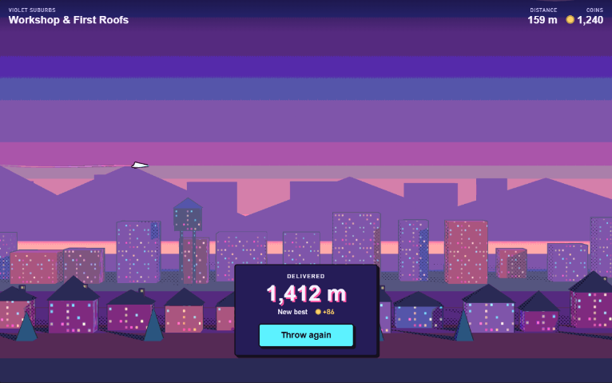
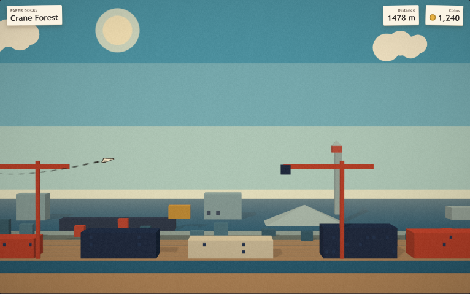
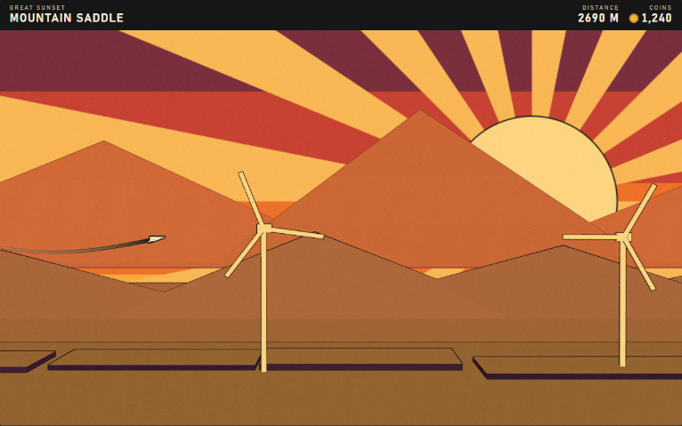
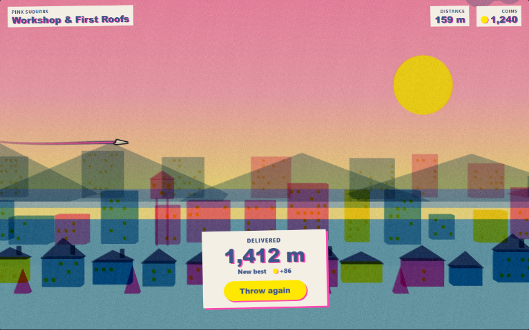
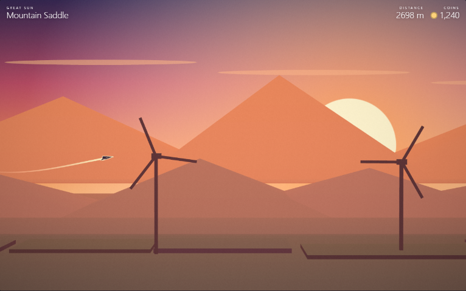

# Nové vizuální směry Just Throw It (průzkum)

> **NÁVRH, nic z toho neplatí.** Platí schválená bible `02-styl.md` (A0), dokud uživatel nerozhodne jinak. Tento dokument je průzkum alternativ na podnět uživatele (14. 10. 2026): „Barevná paleta se mi popravdě nelíbí. A možná ani ten samotný styl. Dalo by se vymyslet úplně jiný styl a identita?“ Napsal art-director. Bible 02 se tímto dokumentem nemění.

**Vyzkoušej to živě:** `npm start` → http://127.0.0.1:4173/prototype-styly.html. Nahoře přepínač 5 stylů, 4 čtvrtí, záběru (výsledek, let, událost s QTE) a velikosti (1280×800, telefon 375×667 a 932×430). Pod scénou jsou 4 pohlednice Atlasu ve stejném stylu. Klávesy ←/→ mění styl, 1–4 čtvrť.

---

## 1. Shrnutí

- Připravil jsem **4 opravdu odlišné směry** a srovnání s dneškem (A0). Každý je v prototypu jako stejná scéna (kus čtvrti, obloha, vlaštovka se stopou, HUD, karta výsledku, QTE kruh a pohlednice), takže se dají porovnat bok po boku.
  - **B Papírové město:** celé město vystřižené z barevného papíru, diorama na stole, denní světlo, měkké stíny mezi vrstvami.
  - **C Cestovní plakát:** starý cestovní plakát „Fly to …“: velké slunce s paprsky, ploché barvy, černá kresba, zúžené verzálky.
  - **D Risograf:** vytištěný fanzin: 2–3 zářivé tiskové barvy, které se přetiskují, zrno papíru, ujetý soutisk.
  - **E Protisvětlo:** klidný let proti slunci: město jako vrstvy siluet v oparu, jemné přechody nebe, vlaštovka vždy opakem nebe.
- **Doporučuji C Cestovní plakát**, těsně za ním E Protisvětlo. C nejlépe sedí k tomu, co hra je (cesta, doručení „Delivered.“, Atlas s pohlednicemi, suchý humor), drží vlaštovku dvojí hranou (bílá výplň + černý obrys, změřeno ≥ 4 : 1 ve všech čtvrtích) a dá se postavit z dnešního 3D (obrysy zůstanou, zmizí půltón, okna a toon rampa). E je nejkrásnější a nejlevnější, ale nejvíc se podobá jiným hrám (Alto) a je tišší, než arkáda s QTE potřebuje. Kap. 7.
- Rozhodnutí je na uživateli (kap. 9, řádky `BLOCKED:` v reportu).

## 2. Co je pevné a co se smí změnit

**Pevné (herní podstata):** papírová vlaštovka, 16 míst ve 4 čtvrtích jednoho města, od Dílny „za obzor“, cesta za sluncem; let z boku s kamerou za vlaštovkou; QTE události (poryvy, ptáci, holub…); Dílna s dítětem; Atlas s pohlednicemi; suchý laskavý humor (06, `research/kb/README.md` P1–P15). Technika: three.js r170 bez build kroku, rozpočty `.claude/rules/render3d.md` (telefon ≥ 30 fps, ≤ 14 draw calls a 15 tis. trojúhelníků na místo), přístupnost (vlaštovka a QTE vždy čitelné, kontrast, reduced motion).

**Smí se změnit:** paleta, materiály, světlo, tvary, typografie, UI, i téma „neonové město“. Pozor: názvy čtvrtí *Violet Suburbs* a *Neon Core* nesou dnešní styl (fialová, neon). Nový směr by je pravděpodobně přejmenoval (v prototypu mají směry pracovní názvy, např. „Sunrise Suburbs“, „Night Metropolis“); to je změna i18n mimo tento úkol (kap. 8).

## 3. Rešerše: co dělá hru „chci to hrát“

| Reference | Co funguje | Proč | Co si beru | Zdroj |
|---|---|---|---|---|
| **Alto's Odyssey / Adventure** | omezená paleta na oblast, tmavé přechody a záře slunce a měsíce, střídání denní doby | jedna nálada na obrazovku, popředí odlišené od pozadí hodnotou, ne detailem; minimalismus nechává prostor představivosti | E: vrstvy siluet a denní doba jako barva čtvrti | [MacStories: rozhovor s H. Nesbittem](https://www.macstories.net/news/appstories-episode-45-an-interview-with-harry-nesbitt-and-ryan-cash-about-altos-odyssey/), [iMore: vývoj Alto's Odyssey](https://imore.com/the-evolution-altos-odyssey-q-and-a), [Kill Screen](https://www.killscreen.com/altos-adventure-creators-tease-next-game-altos-odyssey/) |
| **Tearaway** | svět z papíru, který se chová jako papír (ohyb, přehyb, trhání) | téma je i pravidlo, ne jen povrch; tým stavěl předlohy ze skutečného papíru, omezení 3D „jako stříhání“ | B: město z papíru, papír jako materiál (ne textura), kresba z plochých výřezů | [PocketGamer.biz: Making of Tearaway](https://www.pocketgamer.biz/unfolding-story-the-making-of-tearaway/), [GamesBeat](https://gamesbeat.com/tearaway-is-a-love-letter-to-paper/), [PlayStation Blog: koncepty](https://blog.playstation.com/?p=190010) |
| **Paper Mario: The Origami King** | svět jako pečlivě postavené diorama, papír a origami | hmatatelnost, drobné stíny mezi vrstvami | B: kulisy v hloubce a vržené stíny | [EGM](https://egmnow.com/?p=9994), [Destructoid](https://www.destructoid.com/reviews/review-paper-mario-the-origami-king/) |
| **Monument Valley** | čistá geometrie, pastel, světlo z jednoho směru | silueta a světlo nesou celé místo; architektonické předlohy (Escher, Bofill) | C, E: dominanta místa jako geometrická silueta | [Indiana Scholars Commons](https://collections.libraries.indiana.edu/scholarscommons/items/show/15) |
| **Cestovní a železniční plakáty 1920–40** (Cassandre, Broders, London Transport, WPA) | pár sytých plochých barev, černá kresba, dramatický úhel, malá postava proti velké krajině, písmo jako součást obrazu | omezení litografie a sítotisku vytvořilo jednotný jazyk; černá „klíčová“ barva drží ploché plochy v prostoru | C celé: ploché barvy, černý obrys, slunce s paprsky, „FLY TO …“ | [Poster House: britské železniční plakáty](https://posterhouse.org/blog/railway-posters-from-britain-1923-1939), [London Transport Museum: Art Deco](https://ltmuseum.co.uk/collections/stories/design/brightest-london-art-deco-london-transport-posters), [UAL: How to design a railway poster](https://bagdcontext.myblog.arts.ac.uk/2014/05/19/how-to-design-a-railway-poster/) |
| **Risograf** | jen přímé barvy, průsvitné inkousty se přetiskují do třetí barvy, zrno, ujetý soutisk | nedokonalost tisku je kouzlo; málo barev = silná identita | D celé | [Dribbble: Intro to Risograph](https://dribbble.com/stories/2020/03/02/intro-to-risograph), [LCC Printmaking](https://lccprintmaking.myblog.arts.ac.uk/2021/03/25/print-curiosities-no-6-valley-ii-by-todd-snap/) |
| **Kawase Hasui (shin-hanga)** | měkké přechody nebe (bokashi), soumrak, noc, déšť | celá nálada je v nebi, krajina je klidná | E: přechody nebe; B a C: pásy nebe | [Art in Context](https://artincontext.org/?p=127119), [woodblockprints.org](https://mail.woodblockprints.org/index.php/Detail/entities/11) |
| **Sayonara Wild Hearts** | každá úroveň má vlastní paletu, neon na černé | styl vznikl z nutnosti malého týmu: „výrazné, ale zvládnutelné“ | ponaučení: A0 je bližší Sayonaře než naší hře; neon funguje u rychlé hudební hry, u klouzání za sluncem méně | [EGM: rozhovor se Simogo](https://egmnow.com/lets-pop-simogo-on-building-the-bubblegum-dream-of-sayonara-wild-hearts/), [GamesBeat](https://gamesbeat.com/sayonara-wild-hearts-review-dance-fighting-with-pop-music-and-motorcycles-is-so-fun/) |
| **Mini Metro** | jen tvar a barva, pozadí s nízkým kontrastem, barvoslepý režim | hierarchie zdrženlivostí: pozadí ustoupí, hratelné věci vyniknou | všechny: pozadí tišší než vlaštovka a QTE; stav nikdy jen barvou | [Mechanics of Magic: Visual design of Mini Metro](https://mechanicsofmagic.com/2023/04/22/visual-design-of-games-mini-metro/), [Wikipedia](https://en.wikipedia.org/wiki/Mini_Metro_(video_game)) |
| **Gris** | barva jako příběh: svět začíná bez barvy a postupně barvy přibývají | postup je vidět v samotném obrazu | návrh pro všechny směry: čtvrť = nová barva nebo denní doba (dnes už „cesta za sluncem“) | [GameRevolution](https://www.gamerevolution.com/preview/431593-gris-is-a-gorgeous-colorful-game-that-ironically-isnt-very-gray-preview), [A Garden of Stories](https://agardenofstories.substack.com/p/gris) |
| **A Short Hike** | 3D z co nejmenšího počtu pixelů, ploché stínování, obrysy kvůli čitelnosti | malý tým, jasný styl, nastavitelná velikost pixelu | ponaučení: obrys drží čitelnost u plochých stylů (C), ploché stínování je levné | [PlayStation Blog: Crafting a tiny open world](https://blog.playstation.com/?p=351732) |
| **Old Man's Journey** | ručně kreslené vrstvy krajiny, paralaxa | 3D zkoušeli a zahodili, protože kresba nesla víc emocí | E, B: vrstvy krajiny jako hlavní tvarosloví | [GDC Vault: Happy Inside the Box](https://www.gdcvault.com/play/1024236/), [Game Developer](https://www.gamedeveloper.com/design/road-to-the-igf-broken-rules-i-old-man-s-journey-i-) |

Zjištění napříč referencemi:
1. **Jedna nálada na obrazovku, málo barev.** Alto, plakáty, riso, Mini Metro: síla je v omezení (3–5 barev na scénu). A0 má desítky odstínů a okna ve 4 barvách všude.
2. **Pozadí ustoupí hodnotou (světlostí), ne jen barvou.** Alto a Hasui vrství krajinu do oparu, Mini Metro drží pozadí nekontrastní. A0 má popředí i dálku stejně hlučné (bible kap. 3).
3. **Téma má být i materiál.** Tearaway a Paper Mario: papírová postava v papírovém světě. Dnes je papírová vlaštovka jediná papírová věc v neonovém městě.
4. **Styl z nutnosti.** Sayonara a A Short Hike: malý tým zvolil styl, který jde udělat dobře. Pro nás: plochý styl bez půltónu a textur oken je levnější než A0.

Žádné cizí assety nejsou použité. Prototyp je celý z kvádrů a jehlanů (`src/render3d/geometry.js`).

## 4. A0 dnešek: proč se asi nelíbí

Snímky skutečné hry: `img/desktop-let-1-suburbs.jpg`, `img/desktop-let-4-core.jpg` (bible 02). Prototyp A0 (`img/smery/a0-*.png`) je zjednodušená napodobenina se stejnými materiály (toon, obrysy, půltón, okna ze `src/render3d/toon.js`, barvy z `mood.js`), ve hře je víc detailu (cedule, život, částice).

Moje diagnóza (kvůli srovnání, ne kritika schválené práce):
- **Celé město je v jednom pásmu světlosti a sytosti** (střední až tmavá fialová, indigo, magenta). Nic nedýchá, chybí světlé plochy a „vzduch“.
- **Šum všude:** okna ve 4 barvách na každé budově, půltón, posterizované pásy nebe. Oko nemá kde odpočinout.
- **Neon je výchozí stav, ne akcent.** Když svítí všechno, nesvítí nic (Mini Metro, Alto dělají opak).
- **Téma papíru se ztrácí:** papírová vlaštovka nad kyberpunkovým městem nemá vazbu na svět.

## 5. Čtyři směry

Hodnoty kontrastu: **WCAG poměr změřený z vykresleného snímku** (prototyp, `__styly.measure()`: pixely vlaštovky = ty, které zmizí, když ji skryjeme; pozadí = okolí 48 × 48 px; 5 okamžiků letu, uvádím nejhorší). „Dvojí hrana“ = výplň nebo obrys vlaštovky ≥ 3 : 1 vůči okolí (bible 02 kap. 5 tento cíl má a nové směry ho přebírají). QTE a UI počítané z hex hodnot (disk QTE smíchaný s nejsvětlejším i nejtmavším pásem nebe dané čtvrti, uvádím nejhorší). Barvy: `prototype/styly/styles.js`.

### B Papírové město

**Proč by to chtěl člověk hrát:** papírová vlaštovka konečně patří do svého světa: celé město je vystřižené z barevného papíru a hráč letí nad dioramem, které by si dítě z Dílny postavilo na stole.

**Pilíře:**
1. **Všechno je papír.** Budovy, mraky, slunce jsou ploché výřezy z barevného papíru, stojí ve vrstvách jako kulisy. Žádný neon, žádné textury oken.
2. **Den a teplo.** Cesta za sluncem jako jeden den: ráno → poledne u moře → zlaté odpoledne → večer → úsvit. Světlé, vzdušné.
3. **Hloubku dělá stín, ne obrys.** Měkký vržený stín mezi vrstvami papíru. Obrys (grafit) má jen vlaštovka, takže je jediná „nakreslená“ věc ve světě.
4. **Ruka dítěte.** UI jako papírové štítky a lepicí páska, písmo jako z popisky na krabici.

**Paleta:**

| Role | Hex | Poznámka |
|---|---|---|
| papír (krém) | `#f6eedd` / karta UI `#fbf4e4` | podklad UI, mraky, světlé domy |
| grafit (jediná tuš) | `#2b2725` | obrys vlaštovky 1,8 px, text UI, stopa (tečkovaná tužka) |
| rajčatová | `#e0533a` (tlačítko `#c4432c`) | akcent: jeřáby, střechy, perfekt QTE |
| tyrkys | `#1f8a8a` (`#2f8f8a` domy) | úspěch QTE |
| hořčice | `#e8b03e` | hodnota (mince) |
| námořnická | `#22355e` / `#2b3f63` | střechy, večerní nebe |
| kraft | `#c8a079` / `#cdb08a` | zem |

| Čtvrť | Denní doba | Nebe (shora → obzor, papírové pásy) | Vrstvy města (dálka / střed / ulice) |
|---|---|---|---|
| 1 Předměstí | ráno | `#7fbfe0` `#a6d4e6` `#cfe6e6` `#f6eedd` | `#bfd6d6` / `#e7a28f` `#f2c48d` `#a9c6b8` / `#e0533a` `#f2b84b` `#2f8f8a` `#f6eedd` |
| 2 Doky | poledne u moře | `#4fa3d1` `#7cbde0` `#b5dbe9` `#e9f2ef` | `#9ec2d6` / `#3d6f8f` `#e8b03e` `#e0533a` / `#22355e` `#c8a079` `#f6eedd`, moře `#2c6e9b` |
| 3 Horizont | zlaté odpoledne | `#f1b45a` `#f6cb7c` `#f9dfa6` `#fbeccc` | `#d9967a` / `#d9a35a` `#c98a4a` / `#b8863b` `#f6eedd` `#8fb07a` |
| 4 Jádro | večer | `#1d2b4d` `#2b3f6b` `#4a5f8f` `#e08a74` | `#3a4a73` / `#2b3f6b` `#33497a` / `#1d2b4d` `#e0533a` `#2f8f8a`, okna z hedvábného papíru `#f2c14e` |

**Změřený kontrast vlaštovky:** výplň 1,22–1,44 v denních čtvrtích (bílý papír na světlém nebi splývá), obrys grafit 5,6–7,6 → drží obrys. V Jádru výplň 6,6, obrys 1,07 → drží výplň. Dvojí hrana splněna všude, ale vždy jen jednou hranou. **QTE** na papírovém disku: stopa 3,1, úspěch 3,3, perfekt 3,0 (tvar hvězdy navíc), ukazatel 11,7. UI: text 13,5, popisek 5,7, tlačítko 4,8.

**Materiály a světlo:** `MeshLambertMaterial` s barvou vrcholů, jedno směrové světlo s měkkými stíny (`PCFSoftShadowMap`), silná hemisféra, aby barvy papíru zůstaly čisté. Kulisa nebe chytá stíny vrstev. Post: zrno papíru 5 %, tón papíru, lehká vinětace.

**Tvarosloví:** vrstvy jako tenké kulisy (hloubka 3–8 m) blízko sebe (diorama). Střechy jehlany, stromy kužely, mraky z kruhů. Okna jen jako malé tmavé výřezy, ne svítící mřížka.

**Typografie a UI:** Trebuchet MS / Gill Sans tučně (návrh: oblé humanistické bezpatkové), papírové štítky lehce natočené, lepicí páska, měkký stín „zvednutého papíru“. Bez tvrdých rámů.

**Dílna:** skutečný stůl dítěte: řezací podložka, nůžky, pastelky, rozestavěné papírové město na stole za oknem. Vlaštovka v ruce. Přirozeně navazuje: hráč vylétne z Dílny do města, které je ze stejného papíru.
**Atlas:** pohlednice jako polaroidy přilepené páskou do sešitu (`img/smery/b-pohlednice.png`), podpis rukopisným písmem.
**QTE:** papírový kroužek se stínem (zvednutý nad scénu), grafitová stopa, tyrkysová úspěch, rajčatová perfekt + hvězda. Poryv = papírový proužek, holub = origami holub.

**Riziko:** (1) bílá vlaštovka na světlém dni drží jen grafitový obrys; na telefonu je obrys 1,8 px tenký, potřeboval by ≥ 2,5 px. (2) Měkké stíny jsou na telefonu nejdražší ze všech směrů (stínová mapa 2048², PCF). (3) Bez papírové textury a nedokonalých okrajů hrozí dojem „levné kartonové krabice“. (4) Večerní Jádro je tmavé a na večer papírový styl ztrácí výhodu.
**Práce v three.js:** zůstane kamera, rozvržení (`districts/*-layout.js` s menší hloubkou), `geometry.js`, `frame.js`, `life.js`. Přepíše se `toon.js` (bez toon rampy, půltónu a oken), `scene.js` (stíny, kulisy), `palette.js`, barvy v `mood.js`, `style.css`, `prototype/atlas/art.js`, Dílna. Nově papírová textura okrajů. **Odhad: velká přestavba, 8–12 pracovních dávek.**
**Výkon (prototyp, 1280×800, DPR 1,25):** 27–28 draw calls (včetně stínového průchodu), 3,3–10,4 tis. trojúhelníků, CPU ~1 ms na snímek. GPU a telefon NOT ASSESSED (stíny jsou hlavní riziko).

### C Cestovní plakát

**Proč by to chtěl člověk hrát:** každý okamžik letu vypadá jako starý cestovní plakát „Fly to the Horizon“: velké slunce, ploché barvy, černá kresba a dramatické siluety.

**Pilíře:**
1. **Každý záběr je plakát.** Ploché barvy (3 tóny na tvar: světlo, čelo, stín), žádné přechody, žádné textury. Málo barev na čtvrť.
2. **Černá kresba drží svět.** Jedna černá „klíčová“ barva `#161616` obtahuje vše; vlaštovka má nejsilnější obrys (3 px) a čistě bílou výplň.
3. **Slunce je hlavní postava cesty.** Velké slunce s paprsky v každé denní čtvrti, v noci měsíc a reflektory. Cesta za sluncem je vidět na první pohled.
4. **Písmo je součást obrazu.** Zúžené geometrické verzálky, „FLY TO …“, „DELIVERED“. Humor jako parodie dobových reklam.

**Paleta:**

| Role | Hex | Poznámka |
|---|---|---|
| klíčová černá | `#161616` | obrysy 2,2 px (vlaštovka 3 px), pás HUD, tlačítka |
| krém (papír plakátu) | `#f3ead2` | karty UI, stopa, text na černé |
| plakátová červená | `#c94a35` | akcent, podtržení tlačítka |
| perfekt | `#ff7a5c` | QTE perfekt (+ hvězda) |
| úspěch | `#7fd1e0` | QTE úspěch |
| hodnota | `#f2b33d` | mince, okna v noci |

| Čtvrť | Denní doba | Nebe (pásy) + slunce | Vrstvy (dálka / střed / ulice) |
|---|---|---|---|
| 1 Předměstí | jitro | `#f4c98a` `#f6d9a4` `#f8e7c2` `#fbf1da`, slunce `#f07a4f`, paprsky `#f6b98a` | `#8fb3c4` / `#e8836a` `#d9644a` / `#2d5b7a` `#c94a35` `#f3ead2` |
| 2 Doky | měsíční noc | `#162a4a` `#1f3d66` `#2e5a87` `#3f72a0`, měsíc `#f3ead2` | `#24456e` / `#142640` / `#0e1a2e`, jeřáby a okna `#f2b33d` |
| 3 Horizont | velký západ | `#7b2d4a` `#c8453a` `#ec7a2f` `#f6b54a`, slunce `#fde3a0` | `#b84a45` / `#6e2a45` / `#2e1430` |
| 4 Jádro | noční metropole | `#0f1426` `#1b2244` `#2c3366` `#4a3f7a`, reflektory `#f3ead2` | `#232a52` / `#171c3a` / `#0c0f20`, okna `#f2b33d` `#e85d4a` `#7fd1e0` |

**Změřený kontrast vlaštovky:** denní čtvrti: výplň 1,4–1,5, obrys 4,0–5,8 → drží černý obrys; noční: výplň 5,1–10,5 → drží bílá výplň. **QTE** (černý disk 85 %): stopa ≥ 9,9, úspěch ≥ 6,9, perfekt ≥ 4,7, ukazatel ≥ 11,9. UI: krém na černé 15,1, popisek 9,9, karta 15,1.

**Materiály a světlo:** neosvětlený plochý shader (tón podle normály: střecha ke světlu, bok ke stínu), mlha jen jako „vzdušná perspektiva“ po vrstvách. Žádná toon rampa, žádný půltón, žádné stínové mapy. Nebe kreslené do plátna (pásy + paprsky). Post: jemné zrno tisku 3,5 %.

**Tvarosloví:** dnešní kvádry a jehlany zůstanou; dominanta místa (maják, věž, hory, větrníky) jako čistá silueta s obrysem. Okna jen v noci a jen jedna až tři barvy, v dálce bez oken.

**Typografie a UI:** Futura / Century Gothic / Bahnschrift, verzálky s prostrkáním. HUD jako černý pás plakátu nahoře, karta výsledku krémová s 3px černým rámem bez zaoblení, tlačítko černé s červenou linkou.

**Dílna:** dílna jako stará cestovní kancelář nebo pošta: plakáty na zdi, razítka, mapa s trasou. Dítě v čepici pošťáka. Navazuje na Kraft papír („letecká pošta“, 06) a „Delivered.“.
**Atlas:** pohlednice = skutečné cestovní plakáty „FLY TO CRANE FOREST“ (`img/smery/c-pohlednice.png`). Nejsilnější vazba Atlasu na hru ze všech směrů.
**QTE:** černý disk s krémovou stopou, azurová úspěch, korálová perfekt + hvězda; nápis „GUST!“ v černém štítku jako titulek plakátu.

**Riziko:** (1) paprsky slunce jsou výrazné, ve výšce letu nesmí rušit (prototyp: vlaštovka drží obrys 4,0 i před paprsky; na telefonu NOT ASSESSED v pohybu). (2) Černý pás HUD na telefonu zabírá místo. (3) „Retro“ může působit vážně; humor musí nést texty a postavy. (4) Proti A0 se mění celé UI.
**Práce v three.js:** zůstane kamera, rozvržení, `geometry.js`, **obrysy (`toon.outlineMaterial`, `stampOutlineMaterial`)**, stopa s lemem, `frame.js`, `life.js`. Přepíše se materiál budov (plochý 3-tónový místo toon + okna + půltón), `postPass` (jen zrno), obloha (pásy a paprsky), `palette.js`, `mood.js` (méně parametrů: nebe, slunce, mlha), `style.css` na nové tokeny, `art.js`. **Odhad: střední přestavba, 6–9 dávek.**
**Výkon:** 16–19 draw calls, 3,2–13,9 tis. trojúhelníků (Jádro), CPU ~0,9 ms. Bez stínových map a půltónu je levnější než A0. GPU a telefon NOT ASSESSED.

### D Risograf

**Proč by to chtěl člověk hrát:** hra jako vytištěný fanzin: dvě tři zářivé tiskové barvy, které se přetiskují přes sebe, zrno papíru a lehce ujetý soutisk, vtipné a hravé.

**Pilíře:**
1. **Jen tiskové barvy.** Každá čtvrť = 2–3 inkousty (růžová, modrá, žlutá, oranžová, tyrkys, fialová) na krémovém papíře. Překryv barev = nová barva (násobení).
2. **Nedokonalost je kouzlo.** Zrno, ujetý soutisk 1,6 px, lehce natočené štítky.
3. **Vlaštovka je nepotištěný papír s černým klíčem.** Jediná věc tištěná černou.
4. **Hravost a humor.** Těžké groteskové písmo, žluté tlačítko, posunuté stíny.

**Paleta (inkousty jako inspirace RISO):** papír `#f4efe4`, černá `#1d1d24`, fluo růžová `#ff48b0`, modrá `#0078bf`, žlutá `#ffe800`, oranžová `#ff6c2f`, tyrkys `#00838a`, federální modrá `#3d5588`, fialová `#765ba7`, červená `#ff665e`, malinová `#d1517a` (perfekt QTE).

| Čtvrť | Inkousty | Nebe |
|---|---|---|
| 1 Předměstí | růžová + modrá + žlutá | růžová 55 % → žlutá 18 % |
| 2 Doky | federální modrá + tyrkys | federální 95 % → tyrkys 40 %, měsíc = nepotištěný papír |
| 3 Horizont | oranžová + žlutá + červená | oranžová 75 % → žlutá 45 %, slunce = nepotištěný papír |
| 4 Jádro | fialová + růžová + modrá | fialová 80 % → růžová 45 % |

**Změřený kontrast vlaštovky:** nejhorší 3,2–3,9 (dvojí hrana splněna těsně). S obrysem ve federální modré (první verze) jen 2,3–2,5, proto černý klíč 3 px. **QTE** (papírový disk): stopa ≥ 5,9, úspěch ≥ 3,7, perfekt ≥ 3,3, ukazatel ≥ 13,5. UI: modrý text na papíře 6,4, tlačítko 5,9.

**Materiály:** plochý shader, budovy průsvitné s násobením (přetisk), zem kryje. Post: ujetý soutisk (tmavší kopie posunutá o 1,6 px), zrno 9 %, tón papíru.
**Tvarosloví:** jako dnes, ale bez obrysů; tvar nese překryv barev. Okna jako tečky jedné barvy.
**Typografie a UI:** Arial Black / Impact, text federální modrou s růžovým posunutým stínem, papírové štítky, žluté tlačítko „pilulka“.
**Dílna:** stůl s tiskárnou, rozházené výtisky, dítě s inkoustem na rukou. **Atlas:** pohlednice jako riso tisky s velkým posunutým nápisem (`img/smery/d-pohlednice.png`). **QTE:** papírový disk, modrá stopa, malinová perfekt + hvězda, žlutý štítek „GUST!“.

**Riziko (nejvyšší):** (1) přetisk míchá barvy do bláta (zelená z modré a žluté, tmavé Jádro; viz `d-1-predmesti-vysledek.png`, `d-4-jadro-udalost.png`), větrníky v Horizontu skoro zmizí (`d-3-horizont-let.png`). Vyžaduje ruční ladění každé dvojice inkoustů. (2) Čitelnost vlaštovky jen těsně nad 3 : 1. (3) Zrno a soutisk na telefonu „šumí“ (stejný problém jako dnešní půltón). (4) Styl je módní, rychle může zestárnout.
**Práce:** přepíše se materiálová vrstva, pořadí vykreslování průsvitných vrstev, post-proces, všechny palety, UI. **Odhad 7–10 dávek + ladění barev.**
**Výkon:** 16–19 draw calls, 1,9–12,1 tis. trojúhelníků, CPU ~0,9 ms; průsvitné vrstvy = víc přepisování pixelů (overdraw), na telefonu NOT ASSESSED.

### E Protisvětlo

**Proč by to chtěl člověk hrát:** klidný, nádherný let proti zapadajícímu slunci: město jako vrstvy siluet v oparu, jemné přechody oblohy a vlaštovka, která je vždy opakem nebe za ní.

**Pilíře:**
1. **Světlo je hlavní postava.** Nebe s plynulým přechodem a září slunce nebo měsíce; město jsou siluety.
2. **Hloubka oparem.** 3–5 vrstev, čím dál, tím světlejší a bližší barvě nebe (vzdušná perspektiva). Žádné obrysy, žádné textury.
3. **Vlaštovka je opak nebe.** Proti světlu (den) je tmavá se světlým okrajem, v noci bílá. Pravidlo jde odvodit z jasu nebe v `mood.js`.
4. **Ticho a vzduch.** Tenké písmo, žádné rámečky, málo prvků; efekty jen jako záblesk světla.

**Paleta:**

| Čtvrť | Denní doba | Nebe (plynule) | Vrstvy (dálka / střed / ulice) | Vlaštovka (výplň / okraj) |
|---|---|---|---|---|
| 1 Předměstí | zlatá hodina | `#6d5a9e` `#e98a8a` `#ffcf9a` `#fff0c8` | `#e4a08e` / `#b8747f` / `#4a2f48` | `#2b1e33` / `#fff2d6` |
| 2 Doky | modrá hodina | `#0f1c3d` `#1f3d6b` `#4a7aa6` `#9cc6d8` | `#4f7898` / `#2b4867` / `#12213a` | `#f4f7ff` / `#14203a` |
| 3 Horizont | velké slunce | `#3c2a5e` `#c4506a` `#ff9a5a` `#ffe2a0` | `#c96a5a` / `#9a4a55` / `#2e1530` | `#2a1830` / `#ffe9c0` |
| 4 Jádro | noc a záře města | `#0a0c1e` `#16183a` `#2b2758` `#6a4a80` | `#4a3f72` / `#2a2248` / `#120f24`, okna `#ffcf7a` `#ffe6b0` `#9fd8ff` | `#ffffff` / `#9fd8ff` |

Role: úspěch `#a8ecff`, perfekt `#ffb3cf` + hvězda, hodnota `#ffd27a`, QTE disk černý 62 %.

**Změřený kontrast vlaštovky:** Předměstí výplň 6,3, Doky 3,6, Horizont 5,4, Jádro okraj 7,1. Ve všech čtvrtích drží výplň (nebo okraj v noci) nad 3,5. **QTE:** stopa ≥ 5,5, úspěch ≥ 5,2, perfekt ≥ 4,1, ukazatel ≥ 6,8. UI: bílý text nad horní částí nebe 5,8–12,5, karta výsledku na tmavém závoji 62 % ≥ 4,9 (s 52 % jen 4,2, proto 62 %).

**Materiály a světlo:** plochý neosvětlený shader s velmi silnou mlhou podle hloubky, nebe jako plynulý přechod s radiální září. Vlaštovka: plochá výplň + světlý okraj razítkem (`stampOutlineMaterial` dnes). Post: zrno 2,5 %, vinětace.
**Tvarosloví:** jako dnes, ale bez detailu: siluety, okna jen jako drobná teplá světla. Mraky jako tenké pruhy.
**Typografie a UI:** Segoe UI Light / Helvetica Neue, verzálky s velkým prostrkáním, čísla tenká a velká, tlačítko obrysová „pilulka“, bez rámečků.

**Dílna:** silueta dítěte v okně podkrovní dílny proti zapadajícímu slunci, teplé světlo lampy uvnitř. **Atlas:** pohlednice jako fotografie s bílým okrajem a tenkým popiskem (`img/smery/e-pohlednice.png`). **QTE:** tenké prstence na tmavém disku, světlá stopa, růžová perfekt + hvězda; poryv jako světlá vlnka v oparu.

**Riziko:** (1) nejvíc se podobá Alto's Odyssey; bez vlastního nápadu (papír, humor) hrozí „další hezká minimalistická hra“. (2) Je tichá; arkáda s QTE, mincemi a čísly (06: „čísla mají být vidět“) potřebuje víc energie, kterou by musely dodat efekty a UI. (3) Tmavá vlaštovka ve dne mění identitu „bílého papíru“ (bible A0 S1 ji má bílou). (4) Tenké písmo na telefonu potřebuje závoj.
**Práce v three.js:** zůstane kamera, rozvržení, `geometry.js`, `frame.js`, `life.js`, razítkový obrys vlaštovky (jako světlý okraj), stopa. Přepíše se materiál budov (nejjednodušší ze všech), obloha, `palette.js`, `mood.js` (přidat přepínání výplně vlaštovky podle jasu nebe), `style.css`, `art.js`. **Odhad: nejmenší přestavba, 5–8 dávek.**
**Výkon:** 11–14 draw calls, 1,7–10,7 tis. trojúhelníků, CPU ~0,7 ms, nejlevnější. GPU a telefon NOT ASSESSED.

## 6. Srovnání

Hodnocení 1–5 (5 = nejlepší). Radost je můj odhad podle referencí a prototypu, ne test s hráči.

| | A0 Dnešek | B Papírové město | C Cestovní plakát | D Risograf | E Protisvětlo |
|---|---|---|---|---|---|
| Radost / „chci to hrát“ | 2 (uživatel ji nemá rád) | 4 (útulné, téma papíru) | 4 (výrazné, cesta a pošta) | 3 (hravé, ale bláto) | 5 (nejkrásnější) |
| Vazba na hru (papír, cesta, Atlas, humor) | 2 | 5 | 5 | 3 | 3 |
| Čitelnost vlaštovky (změřeno, nejhorší čtvrť) | prototyp 4,0; ve hře 1,07 výplň / 9,2 obrys (bible) | 5,6 (jen obrys ve dne) | 4,0 | 3,2 | 3,6 |
| QTE nejhorší prvek | 2,0 (perfekt magenta na 60% tuši) | 3,0 | 4,7 | 3,3 | 4,1 |
| Práce (5 = nejméně) | 5 | 1 (8–12 dávek) | 3 (6–9) | 2 (7–10 + ladění) | 4 (5–8) |
| Výkon (5 = nejlevnější) | 3 (stíny, půltón) | 2 (měkké stíny) | 4 | 3 (průsvitné vrstvy) | 5 |
| Riziko (5 = nejmenší) | 4 | 2 | 4 | 1 | 3 |
| Originalita | 3 | 4 | 4 | 4 | 2 |

Pozn.: A0 v prototypu měří lépe než ve hře, protože prototyp nemá tónování papíru světlem ani všechny detaily (bible 02 kap. 2.4 měřila ze hry 1,07 výplň v Horizontu a 1,01 stopu v Jádru). U A0 vyšlo nové zjištění: **perfekt QTE magenta na 60% tuši nad světlým nebem má jen 2,0 : 1** (pod 3 : 1), viz kap. 8.

## 7. Doporučení

**C Cestovní plakát**, protože:
1. **Sedí k tomu, co hra je:** cesta za sluncem (velké slunce v každé denní čtvrti), doručování (letecká pošta, „Delivered.“, Kraft papír), Atlas jako sbírka cestovních plakátů. Humor jako parodie dobových reklam („FLY TO CRANE FOREST. By paper, naturally.“).
2. **Čitelnost je nejjistější:** bílá výplň + černý 3px obrys, změřeno ≥ 4,0 : 1 ve všech čtvrtích, QTE ≥ 4,7.
3. **Staví na tom, co funguje:** obrysy, razítkový obrys vlaštovky, stopa s lemem, kamera a rozvržení zůstanou. Zmizí přesně to, co dnes dělá šum (půltón, okna všude, toon rampa, 35 odstínů azurové).
4. **Levnější na výkon než dnes** (bez stínových map a půltónu).

**E Protisvětlo** jako silná druhá volba: nejkrásnější a nejlevnější, ale nejvíc se podobá jiné hrě a je tichý. Kdyby se uživateli nejvíc líbil E, doporučuji do něj přidat papírový prvek (např. vlaštovka a UI papírové, svět v protisvětle), aby měl vlastní tvář.

**B** je tematicky nejhezčí, ale nejdražší a ve dne drží vlaštovku jen tenký obrys. **D** nedoporučuji jako celý styl (riziko bláta a šumu), ale jeho UI (žluté tlačítko, posunutý tisk) by se dalo použít jako akcent.

Navrhovaný další krok (po volbě uživatele): jedna čtvrť ve skutečné hře v novém stylu (ne celá hra), playtest s uživatelem, teprve pak nová bible a plán přestavby. Dotčené soubory a vlastníci viz kap. 8.

## 8. Dopady a rozpory

- **Bible 02 platí,** dokud uživatel nerozhodne. Volba nového směru = nové rozhodnutí v `06-rozhodnuti.md` a nová bible (pilíře, paleta, UI). Dnešní dávky G0–G4 podle bible 02 jsou hotové (git log), další úklid A0 by při změně směru přišel vniveč, proto doporučuji pozastavit nové vizuální dávky do rozhodnutí.
- **Názvy čtvrtí** (`src/locales`: VIOLET SUBURBS, NEON CORE) nesou styl A0. Při změně směru návrh pro product-designera: přejmenovat podle denní doby nebo dominanty (C: Sunrise Suburbs, Moon Harbour, Great Sunset, Night Metropolis; E: Golden Suburbs, Blue Docks, Great Sun, Night City). Jen pracovní názvy.
- **Nový nález v A0 (platí i bez změny směru):** perfekt QTE `#ff4f9e` na tušovém disku 60 % nad světlým nebem má 1,97–2,24 : 1, stopa kruhu `MUTE #a79cd8` 2,4–2,7 : 1 (výpočet z hex, disk smíchaný s pásy nebe z `mood.js`). Bible kap. 5.5 chce ≥ 3 : 1. Návrh pro game-dev: disk 75 % nebo perfekt světlejší (`mix(MAGENTA, PAPER, .3)`). Měřeno analyticky, ve hře NOT ASSESSED.
- **„Perfekt = magenta, zlatá = jen hodnota“** (06, 14. 10.): v nových směrech má perfekt vždy vlastní barvu + tvar hvězdy a hodnota (mince) vlastní teplou barvu; princip „jedna role = jedna barva“ se zachová, konkrétní barvy se změní.
- **Prototyp** (`prototype-styly.html`, `prototype/styly/`) je jen pro srovnání; importuje ze `src/render3d/` (geometry, toon, plane, palette, mood) a nic v `src/` nemění.

## 9. Otázky pro uživatele

Obrázky ke každé otázce jsou v `research/design/img/smery/` a živě v `prototype-styly.html`.

1. **Kterou z pěti bys chtěl hrát?** A0 Dnešek, B Papírové město, C Cestovní plakát, D Risograf, E Protisvětlo. Porovnej např. stejné místo: `a0-3-horizont-let.png`, `b-3-horizont-let.png`, `c-3-horizont-let.png`, `d-3-horizont-let.png`, `e-3-horizont-let.png`. Doporučení: C, druhá E.
2. **Co se ti líbí na referencích?** Alto's Odyssey (klid, světlo, siluety), Tearaway a Paper Mario (svět z papíru), staré cestovní plakáty (ploché barvy, slunce, písmo), riso tisky (zářivé barvy, zrno), Monument Valley (čistá geometrie). Stačí „tohle ano, tohle ne“; pomůže to doladit vybraný směr.
3. **Smí se změnit i název a nálada čtvrtí?** (a) ano, přejmenovat podle nového stylu, (b) názvy nechat (Violet Suburbs, Neon Core), (c) rozhodnout až po výběru stylu. Doporučení: (c).
4. **Jak dál po výběru?** (a) nejdřív jedna čtvrť ve hře v novém stylu a zkusit si ji zahrát, (b) rovnou nová bible a přestavba celé hry, (c) zatím jen ladit A0. Doporučení: (a).

## 10. Jak ověřeno

- Prototyp spuštěn v Chrome (záložka uživatele, okno viditelné, `document.visibilityState = visible`), bez chyb v konzoli. Ověřeno: 5 stylů × 4 čtvrti, záběry výsledek / let / událost, 1280×800, 375×667, 932×430 (telefon simulován velikostí scény, stránka zmenšená, aby se vešla do okna 1536×646), pohlednice. Let běží plynule (statický vzhled posouzen, plynulost na telefonu NOT ASSESSED).
- Snímky `research/design/img/smery/`: pro každý styl `<id>-1-predmesti-vysledek`, `-2-doky-let`, `-3-horizont-let`, `-4-jadro-udalost`, `-mobil-doky-udalost`, `-nasirku-horizont-vysledek`, `-pohlednice` (35 souborů, zmenšené na ~770 px).
- Kontrast vlaštovky změřen z vykreslených pixelů (kap. 5), QTE a UI z hex hodnot.
- Výkon: `renderer.info` a CPU čas na snímek v prohlížeči na notebooku. **GPU čas, telefon (iPhone 15 Pro) a reduced motion v prototypu NOT ASSESSED** (prototyp při `prefers-reduced-motion` jen nespustí let; efekty jako rychlostní čáry, otřes a hitstop v prototypu nejsou).
- **Dílna v nových směrech NOT ASSESSED** (jen popis, prototyp ji nekreslí).
