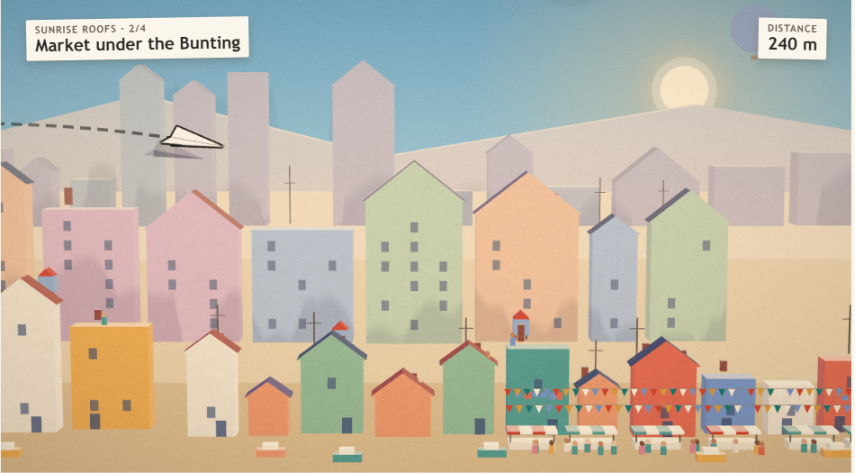
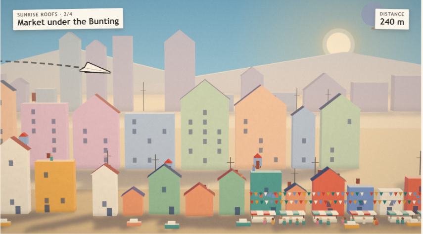
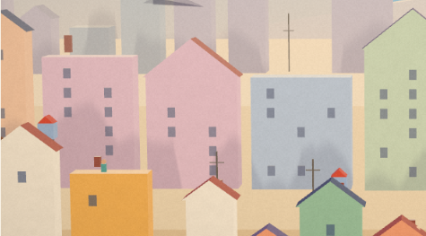
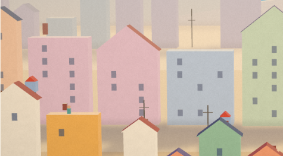

# Stíny v Papírovém městě: rešerše a plán implementace

> **NÁVRH, ke schválení uživatelem.** Napsal art-director 14. 10. 2026 na podnět uživatele: „stíny ve hře vypadají zvláštně … udělej research, jak udělat pěkné stíny do naší hry, a napiš plán implementace“. Navazuje na bibli `05-styl-papir.md` (kap. 4–5) a plán `06-papir-ctvrt1.md` (dávka P1). Dokud uživatel nerozhodne, platí kap. 5 bible 05 („siluety vrstev“).
>
> Agenty jsem spustit nemohl (nemám k tomu nástroj), rešerši jsem udělal sám přes WebSearch.

**Vyzkoušej to:** `npm start` → http://127.0.0.1:4173/prototype-styly.html?stiny. Přepínač „stíny“ nahoře: **NOVÉ: stíny na zem (08)**, **dnes: siluety**, **bez stínů**. Kód návrhu je v `archiv/prototype/styly/stiny.js` (kopie `papir.js` s novým režimem, originál se nemění).

---

## 1. Shrnutí

**Proč dnes stíny vypadají divně:** padají tam, kam fyzicky padat nemohou. Domy v ulici stojí 80 m před domy ve středu a mezi nimi je vidět zem, a přesto na ně kreslíme jejich stín. Navíc je stín rozmazaný do šmouhy bez tvaru (sloupy a antény z něj dělají svislé šmouhy). Je šedofialový přes teplé barvy, takže působí jako špína. Nesedí ani se sluncem, které je na obloze vpravo *za* městem, zatímco stíny se kreslí, jako by svítilo zepředu.

**Návrh „stíny na zem“:**
1. Stín padá jen tam, kam opravdu dopadne: **na zem před kartami**, doleva a dopředu od slunce za městem. Na stěny vzdálených vrstev nic.
2. **Přesný tvar** karty (silueta promítnutá podél světla), jen lehce změkčený.
3. **U paty tmavší a ostrý, dál slabší** (kontaktní stín). Domy pak „stojí“, nevznášejí se.
4. **Barva stínu násobí papír studeným odstínem** (`#5d64a8`), papír zůstane sytý a jen zchladne, žádná šedá.
5. **Jemné ztmavení paty každé karty** (1,4 m v ulici, 2,8 m ve středu): papír stojí na papíře.
6. **Vlaštovka** vrhá svůj tvar na zem stejně jako domy, s výškou slabší a měkčí. Žádná „druhá vlaštovka“ na domech za ní.

Výsledek: stěny jsou čisté, zem má klidné dlouhé stíny ranního slunce a výkon je stejný jako bez stínů (změřeno níže).

| Dnes (siluety) | Návrh (stíny na zem) |
|---|---|
|  |  |
|  |  |

Místo 2 (Trh), stejný okamžik letu (`t=6`), 1280×800. Vlevo jsou šmouhy na růžovém a modrém domě a šedý „duch“ vlaštovky na věži. Vpravo jsou čisté stěny, stíny leží na zemi před domy a domy mají tmavší patu.

## 2. Diagnóza dneška (prototyp `papir.js`, režim `skyline`)

| # | Co je vidět | Proč | Kde v kódu |
|---|---|---|---|
| D1 | rozmazané šmouhy na stěnách domů ve středu | stín ulice se kreslí na kartu za ní, ale mezi vrstvami je 80 m (ulice z ≈ −20, střed −100, dálka −357). Při výšce slunce ~40° dosáhne stín 15m domu jen ~18 m, na střed nedopadne | `SHADOW.casters`, `shadowOffset` (`papir-data.js` ř. 41–43) |
| D2 | stín nemá tvar domu | profil výšek je sjednocení všech karet rozmazané klouzavým průměrem (`skyline(…, {blur:o.pen})`), sloupy, antény a komíny dělají svislé pruhy | `skyline`, `skylineStrip` |
| D3 | domy se vznášejí | stejná měkkost všude, u paty není kontakt (výzkum: oko čte ostrost polostínu jako vzdálenost, viz kap. 3) | `skylineShadowMaterial` |
| D4 | špinavá šedá | alfa 20 % barvy `#3b3560` přes teplé pastely sníží sytost, výsledek je šedohnědý | `D1.shadow`, `SHADOW.alpha` |
| D5 | šedý „duch“ vlaštovky na vzdálených domech | kopie vlaštovky posunutá o 40 m „hloubky“ se kreslí na kartu, která je 100–350 m za ní | `planeShadowMaterial`, `SHADOW.plane` |
| D6 | směr světla odporuje obrazu | slunce je na obloze vpravo za městem, ale stíny i světlé boky počítají se světlem zepředu (`D1.light` má z = +0,6, ke kameře) | `D1.light` |

Ve hře samotné (`src/render3d/`) je dnes ještě styl A0 (komiks, `BasicShadowMap` 2048², tvrdé stíny). Papírový styl ve hře zatím není (dávky P0–P4 podle `06-papir-ctvrt1.md`), proto se návrh týká papírového stylu, ne A0.

## 3. Rešerše: co dělá stíny pěkné

| Zdroj | Co říká | Co si beru |
|---|---|---|
| DeCoro a kol., *Stylized Shadows* (NPAR 2007) [pdf](https://pixl.cs.princeton.edu/gfx/pubs/DeCoro_2007_SS/styleshadows.pdf) | fyzikálně přesné stíny nesou detail, který odvádí pozornost; umělec potřebuje 4 knoflíky: nafouknutí, jas, měkkost, zjednodušení. Řešení v prostoru obrazu | stín počítat v obrazové masce s knoflíky síla, měkkost, barva, nafouknutí |
| Kontaktní stíny: [demofox: proč jsou některé stíny měkké](https://blog.demofox.org/2017/07/01/why-are-some-shadows-soft-and-other-shadows-hard/), [Multi-pass Gaussian Contact-hardening Soft Shadows](https://www.scitepress.org/Papers/2015/53154/53154.pdf), [Unreal fórum](https://forums.unrealengine.com/t/real-penumbra/145775/2) | polostín roste se vzdáleností od dotyku; oko z toho čte vzdálenost; stín měkký i u paty dělá dojem, že objekt plave | u paty ostře a tmavě, dál slaběji (D3) |
| Barevné stíny: [Anthony Hobday, Coloured shadow](https://anthonyhobday.com/sideprojects/visualtechniques/techniques/shadows/coloured-shadow.html), [Winsor & Newton](https://eu.winsornewton.com/blogs/guides/best-colours-for-painting-shadows), [Wayline: hue shifting](https://www.wayline.io/learn/color-palettes/2), [Gooch tónový model](https://users.cs.northwestern.edu/~ago820/thesis/node26.html) | stín není černá ani šedá; tmavší vlastní barva posunutá ke studené (modrá, fialová); černá do žluté dá „špinavou olivu“ | násobení studeným odstínem místo šedé alfy (D4) |
| Falešné stíny pro mobil: [Unity Learn: Shadows](https://learn.unity.com/tutorial/shadows-3224), [Game Developer: Fake/Accurate shadows in Unity for mobiles](https://www.gamedeveloper.com/design/fake-accurate-shadows-in-unity-for-mobiles), [80.lv: sprite shadows](https://80.lv/articles/faking-global-illumination-with-sprite-shadows-in-unity/) | „blob“ a promítnuté (zkosené) stíny jsou na mobilu standard; levnější než shadow map | promítnutí siluety na zem (planární stín) |
| Shadow mapy v three.js: [three.js fórum: optimalizace stínů](https://discourse.threejs.org/t/how-to-optimize-shadow-rendering-in-three-js-for-better-performance/64681), [three.js issue #8933 (PCSS)](https://github.com/mrdoob/three.js/issues/8933), [Filament: shadows](https://www.mintlify.com/google/filament/rendering/shadows) | PCFSoft je drahý, VSM „prosvítá“ u tenkých objektů, PCSS není v jádru; každé stínící světlo kreslí scénu znovu; na mobilních GPU je i malé PCF drahé ([studie 2014](https://unpaywall.org/10.5220%2F0004666901810188)) | shadow map ne (tenké papírové karty = nejhorší případ pro VSM i bias) |
| SSAO [N8AO](https://github.com/N8python/n8ao) | kvalitní, ale celoobrazovkový průchod; nesmí ztmavovat přímé světlo; s MSAA nefunguje | ne; místo něj levné ztmavení paty karty |
| Papírové diorama: [Tearaway (Game Informer)](https://www.gameinformer.com/b/news/archive/2013/03/28/media-molecule-talks-about-crafting-the-world-of-tearaway.aspx), [Paper Mario (EGM)](https://egmnow.com/?p=9994), papírové ilustrace (vrstvy 5–7 rovin, měkký stín mezi vrstvami) | stín mezi vrstvami funguje, když jsou vrstvy *blízko* (centimetry) a kamera je kolmo; u nás je mezi vrstvami 80–260 m viditelné země | stín mezi vrstvami jen tam, kde jsou karty opravdu blízko (stánky před domem); jinak na zem |

Technické detaily stínů v Tearaway a Paper Mario jsem nedohledal (žádná přednáška ani rozbor). Neověřeno, neodhaduji.

## 4. Možnosti

| Technika | Vzhled | Výkon (změřeno v prototypu, notebook, 1200 × 675, 90 snímků) | Riziko | Verdikt |
|---|---|---|---|---|
| A Dnes: siluety vrstev + stencil | šmouhy, bez kontaktu, „duch“ vlaštovky (D1–D6) | 26 DC hlavního průchodu, 14,9 tis. △, GPU 5,42 ms | | ne |
| **B Stíny na zem** (promítnutí siluet podél světla do masky 1/3 rozlišení, rozmazání, zem masku čte) + ztmavení paty | přesné tvary, kontakt, čisté stěny, dlouhé ranní stíny | 17 DC hlavního průchodu + 13 kreslení do masky + 2 průchody rozmazání, 11,2 tis. △, **GPU 5,63 ms (bez stínů 5,75 ms, rozdíl v šumu měření)** | stíny jsou na úzkém pásu země méně výrazné; karty na sebe stín nevrhají | **doporučuji** |
| C Shadow map 1024 jen ulice | tvrdší, „plave“ s kamerou, akné na tenkých kartách | +0,07–0,1 ms (bible 05) | bias u tenkých karet, telefon | ne |
| D Shadow map 2048 PCFSoft (04) | realistické, tmavé, ztrácí opar | +0,06–0,3 ms, na telefonním rozlišení +27 % (bible 05) | nejdražší | ne |
| E SSAO | jemný kontakt všude | celoobrazovkový průchod | s MSAA nejde, halo | ne |
| F Posun masky na kartu za ní (zkoušel jsem: `stiny.js` historie) | na stěnách nic, protože stín fyzicky nedopadne | | | ne |

## 5. Pravidla vzhledu stínů (návrh do bible 05, kap. 4–5)

- **S-1 Jedno slunce.** Směr stínu = směr ke slunci na obloze. Slunce je ve čtvrti 1 vpravo za městem → stíny doleva a dopředu (ke kameře). Světlo: `[0,62; 0,5; −0,6]` (dnes `+0,6`, oprava D6). Boky karet stínovat podle téhož směru.
- **S-2 Stín jen tam, kam padá.** Na zem (všechny vrstvy) a na kartu jen tehdy, když je vrhač blíž než ~10 m (stánek před domem, komín na střeše). Vlaštovka vrhá stín na zem pod sebou, nikdy na vzdálené domy.
- **S-3 Tvar před měkkostí.** Silueta je přesná a jen lehce změkčená: rozmazání 1 px masky (≈ 3 px obrazu). Žádné sjednocené profily.
- **S-4 Kontakt.** U paty síla 100 %, nad 45 m výšky vrhače nejvýš 55 % (`fade [0, 45, 0,45]`). Pata každé karty tmavší o 20 % do výšky 1,4 m (ulice), 2,8 m (střed), 6 m (dálka).
- **S-5 Barva.** Stín násobí podklad studeným odstínem `#5d64a8` silou 0,62. Nikdy šedá alfa. Na opar se stín aplikuje *před* oparem, takže v dálce sám slábne.
- **S-6 Vlaštovka.** Stín vlaštovky slábne s výškou `exp(−výška / 70 m)`. Nesmí být tmavší než její obrys a nikdy nejde přes ni.
- **S-7 Čitelnost.** Stín nesmí snížit kontrast vlaštovky ani QTE (padá na zem, vlaštovka letí nad ní). Ověřit `measure()` před a po.
- **S-8 Večer (Město lampionů).** Slunce zapadlo, stíny slabší (0,3) a teplé lampiony bez vlastních stínů.

## 6. Plán implementace (pro game-deva, navazuje na `06-papir-ctvrt1.md`)

Stíny jsou v dávce **P1 Scéna**. Návrh mění jen její obsah. Stencil pro stíny už není potřeba, P1 se tím zjednoduší.

| Krok | Soubory | Co | Test a ověření |
|---|---|---|---|
| **S0 Schválení** | `archiv/prototype/styly/stiny.js` (hotovo) | uživatel porovná režimy „stíny na zem“ × „siluety“ | `BLOCKED` níže |
| **S1 Čistá data** | `src/render3d/paper-shadow.js` (nový, čistý) | `shadowLight(mood)` (směr z polohy slunce v náladě, z < 0, když je slunce za městem), `SHADOW_LOOK` (tint, síla, fade, rozmazání, AO výšky podle vrstvy, vlaštovka), `projectToGround(p,L)` jako referenční funkce pro test | `tests/render3d-paper-shadow.test.js`: projekce bodu leží na y = 0 a posun odpovídá směru světla; fade monotónní; čtvrť 1 má stíny doleva (x < 0) a ke kameře (z > 0). Přidat modul do `render3d-purity.test.js` |
| **S2 Maska** | `src/render3d/paper.js` | `shadowProjectMaterial()` (vertex: `w −= L·(w.y/L.y)`, síla podle výšky, MaxEquation do R), `shadowBlur()` (2 průchody, 5 vzorků), render targety 1/3 rozlišení bez hloubky, `dispose` při ztrátě kontextu | vizuálně A/B ve 3 velikostech; `renderer.info.memory` se po 10 hodech nezvyšuje |
| **S3 Příjemci** | `src/render3d/paper.js` (`paperMaterial`), `scene.js` | uniformy `tMask`, `res`, `tint`, `k`; zem čte masku na `gl_FragCoord`; AO paty podle vrstvy; `scene.apply` nastaví směr a sílu z `plan.mood` | šedotónový test (bible 02 kap. 5): vlaštovka první; stěny bez šmouh |
| **S4 Vlaštovka** | `src/render3d/plane.js` | sdílená geometrie vlaštovky v masce (matice z `mesh.matrixWorld`, žádná alokace ve snímku); smazat `planeShadowMaterial` | `measure()` kontrast vlaštovky ≥ hodnoty bez stínu |
| **S5 Kvalita** | `src/render3d/quality.js` | 0: jen AO paty (bez masky); 1: maska 1/4, 1 rozmazání; 2: maska 1/3, 2 rozmazání | `__r3d.bench` na všech úrovních |
| **S6 Úklid** | `papir-data.js` → `paper-*.js`, bible 05 | smazat `skyline`, `skylineStrip`, `SHADOW.casters`, stencil masky stínů; přepsat kap. 4–5 bible 05 podle kap. 5 tohoto dokumentu | `npm test` |

**Rozpočet:** maska = 1 kreslení na vrstvu na místo (dnes 3 pruhy siluet na místo, tedy stejně) + vlaštovka + 2 celoobrazovkové průchody v 1/3 rozlišení (400 × 225 při 1200 × 675, 5 vzorků). V prototypu GPU beze změny proti „bez stínů“ (5,63 × 5,75 ms, v šumu). Draw calls hlavního průchodu klesnou z 26 na 17, protože odpadnou pruhy siluet. Masku lze sloučit do 1 kreslení na místo (vrstvy jednoho místa v jedné geometrii), rozpočet 14 DC na místo platí s rezervou.

**Telefon NOT ASSESSED** (iPhone 15 Pro nebyl k dispozici). Riziko je malé: maska je malá a nemá hloubku, žádná stínová mapa.

**Odhad:** S1–S4 jedna dávka game-deva (součást P1), S5–S6 půl dávky.

## 7. Otázky pro uživatele

1. **Líbí se ti „stíny na zem“ víc než dnešní?** Porovnej `img/stiny/dnes-misto2-celek.png` a `img/stiny/navrh-zem-misto2-celek.png`, nebo živě `archiv/prototype-styly.html?stiny` (přepínač stínů). Doporučuji nové.
2. **Jak výrazné?** (a) jako v ukázce (jemné, ranní), (b) výraznější a delší (síla 0,8, víc „Alto“), (c) skoro žádné, jen tmavší pata domů. Doporučuji (a) ve dne, (b) jen v Zlatých polích (nízké slunce).

## 8. Ověření

- Prohlížeč: záložka uživatele, okno viditelné, `visibilityState = visible`, bez chyb v konzoli. Snímky 1280×800 (zmenšené na 855 px), místo 2, `t = 6`.
- Výkon `__stiny.bench(mode, 90)`: `zem` 17 DC / 11,2 tis. △ / GPU 5,63 ms, `skyline` 26 / 14,9 tis. / 5,42 ms, `off` 17 / 11,2 tis. / 5,75 ms (Chrome, notebook, timer query). Počet DC je jen hlavní průchod (maska a rozmazání nejsou započtené).
- Kontrast vlaštovky (`__stiny.measure()`, místo 2, t = 5, 6, 8, 11): obrys × okolí 7,7–8,7 v obou režimech (beze změny), výplň 1,4–1,6 (ráno drží obrys, jako v bibli 05). Nový stín čitelnost nesnižuje.
- NOT ASSESSED: telefon, ostatní čtvrti (prototyp má jen čtvrť 1), Dílna a výsledek s novým stínem.
